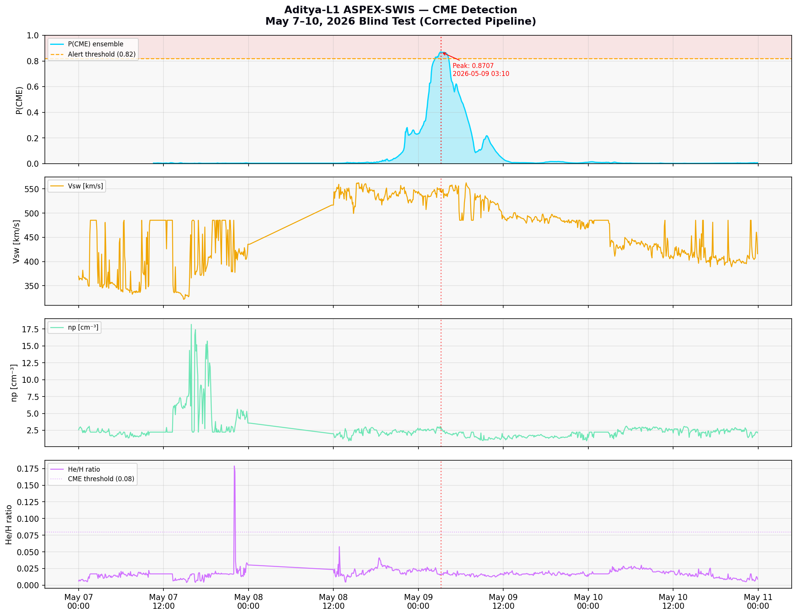

# Aditya-L1 ASPEX-SWIS CME Detection Pipeline v2.0

> Coronal Mass Ejection detection from in-situ solar wind plasma
> measurements made by ISRO's Aditya-L1 spacecraft at the Sun-Earth L1
> Lagrange point. A research prototype: see Known Issues before reusing it.



---

## What This Project Does

Coronal Mass Ejections (CMEs) are billion-tonne eruptions of magnetised 
plasma from the Sun. When they reach Earth, they trigger geomagnetic 
storms that can knock out satellites, damage power grids, and disrupt 
GPS and radio communications. The strongest storm in 20 years hit in 
May 2024, causing aurora visible as far south as India.

This project builds a CME detection model that reads Level-2 solar wind
plasma data (density, speed and thermal speed) from India's first
space-based solar observatory,
**Aditya-L1**, and outputs, for each short window of data, a probability
that a CME is passing the sensor.

The system was trained on data from Solar Maximum (2024–2026), the
most active period of the current solar cycle, and then run on a window
it never saw in training, the May 2026 solar eruption, as a blind test.
See Key Results for which numbers have been reproduced.

---

## Key Results

| Metric | Value | Status |
|--------|-------|--------|
| Validation F1 (TCN; threshold 0.82 chosen on this set) | **0.3101** | reproduced |
| Test F1 (TCN; held-out test split, threshold 0.82) | 0.25 | re-run |
| Test ROC-AUC / PR-AUC (TCN; 3.2% positives) | 0.87 / 0.15 | re-run |
| Validation F1 (ensemble) | 0.3182 | logged, not reproduced |
| Blind test peak P(CME) (ensemble) | 0.8707 | logged, not reproduced |
| Alert threshold crossed (ensemble) | 23 windows above 0.82 | logged, not reproduced |
| Peak detection time (ensemble) | May 9, 2026 at 03:10 UTC | logged, not reproduced |
| Physics check | He/H = 0.2965, Vsw = 598 km/s | logged; not at the detection time |

A later re-run, using the original training arrays (not included in
this repository), reproduced the TCN's validation F1 of 0.3101 and
scored it on the pipeline's own held-out test split: F1 0.25 at the same
threshold. Both scores are optimistic. The windows overlap (128 samples
at a stride of 16) and the split is random, so about three quarters of
the validation and test windows share at least 112 of their 128 samples
with a training window. All 1,400 positive windows also sit in one
contiguous block of the training arrays (the Data Strategy table lists a
single positive period, the May 2024 storm), and every validation and
test positive overlaps a training window, so these splits do not test
detection of a CME the model has not seen. The other numbers come from
training and test logs and could not be reproduced from the shipped
files, so treat them as logged, not verified. The logged physics-check
values occur in the raw 5 s data only as single samples about 14 hours
before the probability peak; at the peak, He/H was about 0.016, close
to its quiet-wind median of about 0.017. The event labels also have no documented source yet.

An F1 around 0.25 to 0.31 is low, mostly because of false alarms: at the
0.82 threshold about 4 of every 5 alerts are false (precision 0.17 to
0.21, recall 0.51 to 0.62). Solar-maximum shocks and streams that
resemble CME signatures are a likely cause. Some CMEs also leave only a
weak plasma signature at L1, which limits recall for any model that
reads this data alone.

---

## The Science Behind It

### Why CME Detection is Hard

The ASPEX-SWIS instrument is a single point sensor. It only sees the 
solar wind when it physically arrives at L1, 1.5 million km from Earth. 
There is no advance warning in the plasma stream for many events. 
Additionally, during Solar Maximum, the sun produces frequent minor 
shocks and high-speed streams that look similar to CME signatures — 
creating a high false-positive environment.

### Key Physical Signatures Used

| Feature | Physical Meaning | CME Signature |
|---------|-----------------|---------------|
| Vsw | Solar wind proton speed | +200–500 km/s jump at shock front |
| np | Proton number density | 3–10× enhancement in CME sheath |
| log₁₀(Tp) | Proton temperature (constant for every ASPEX input in this pipeline; see Known Issues) | Physically: spike at shock, drop in magnetic cloud (not available to this model) |
| He/H ratio | Alpha-to-proton density ratio | 0.08–0.30 in ejecta vs ~0.04 quiet |
| Plasma β proxy | np × v_th / Vsw² (v_th = proton thermal speed; true β needs the magnetic field) | High in the hot, dense sheath; low in the cold magnetic cloud |
| ΔVsw/Δt | Speed gradient | Sharp positive spike at leading edge |
| dV/dt | Smoothed speed gradient | Shock ramp shape |
| dn/dt | Smoothed density gradient | Density pile-up profile |

The **He/H ratio** is the most physically meaningful CME indicator in 
this feature set. Solar wind from CME ejecta contains proportionally 
more helium than quiet wind — a signature of the CME's origin deep in 
the solar corona. The logs of the May 2026 blind-test run report He/H
peaking at 0.2965, but the plotted series in the headline figure does
not show it (see Key Results).

---

## Architecture

The repository's code defines one model, the TCN below. A second model
with an attention layer (TCAN) was trained and combined with the TCN in
the logged runs behind the blind-test figure; its code is not in this
repository. The shipped checkpoints do not yet load with the shipped
loader (see Known Issues).

### Model 1: TCN — Temporal Convolutional Network (Shock Specialist)

Input (128 steps × 8 features)
→ 1×1 Projection (8 → 64 channels)
→ 6 × ResidualTCNBlock (dilation = 1, 2, 4, 8, 16, 32)
→ Global Average Pooling
→ FC(64 → 32) → GELU → Dropout
→ FC(32 → 1) → Sigmoid

Each ResidualTCNBlock uses **causal dilated convolutions**, so the
convolutions only look at past data, never future. The preprocessing
does use a few future samples (centred Savitzky-Golay smoothing, a
centred rolling median and backward gap filling), so live use would
need causal versions of those steps. Each block stacks two causal
convolutions, so the six blocks see **253 consecutive steps** (the
current one and 252 before it), more than the 128-step input window:
every prediction can draw on the whole window. The pipeline does not
resample, so a step is one native sample (2.5 to 5 s in the files
checked) and a window covers **about 5 to 11 minutes** of solar wind.

TCNs were chosen over LSTMs because:
- No vanishing gradients (residual connections)
- Parallelisable on GPU (LSTMs are sequential)
- Mathematically interpretable receptive field
- Scored higher than a BiLSTM in the training logs (validation F1 0.31
  against 0.20); the BiLSTM run is not in this repository and may not
  have used the same features, threshold tuning or split

### Model 2: TCAN (weights only, code missing)

As originally described, a second model added a **multi-head attention
layer** after the TCN blocks so that it could relate distant time steps
directly. Its trained weights are in `saved_models/tcan_champion.pth`:
the parameter names show a full TCN (with its own head), a PyTorch
multi-head attention layer (width 64; the number of heads is not
recorded) and a second classifier head. The class that defines the
model is not in this repository, so it cannot be rebuilt or re-run from
these files.

### Ensemble (logged, not reproducible from this repository)

The logged runs combined the two models as
P(CME) = 0.70 × P_TCN + 0.30 × P_TCAN, with the weights chosen on the
validation set. The ensemble's validation F1 of 0.3182 comes from
training logs and was measured on the same validation set used to pick
the weights. The blind-test figure and the blind-test rows in Key
Results are ensemble outputs. The inference engine in
`predict_streamlit.py` is written for the TCN only.

---

## Data Strategy

The training dataset was not built from a random date range. Four 
strategic pillars were selected to teach the model specific physics:

| Pillar | Date Range | Physics Profile | Purpose |
|--------|-----------|-----------------|---------|
| Extreme Positive | May 10–17, 2024 | G5 geomagnetic storm, Vsw > 800 km/s | Teach textbook CME shock signatures |
| Normal Negative | Jul–Aug 2025 | Active sun, no eruptions | Establish true quiet-wind baseline |
| Noisy Active | Jan–Feb 2026 | Solar Maximum noise, 2026 sensor profile | Reduce false positives from solar cycle noise |
| Blind Test 🔒 | May 7 to 10, 2026 | Mother's Day eruption, unseen data | Final real-world validation only |

**Total: 44,103 sequences** of 128 time steps each, with a CME event
rate of 3.2%. A step is one native sample (2.5 to 5 s in the files
checked), so a sequence covers about 5 to 11 minutes.

### Signal Processing

Raw CDF data undergoes the following pipeline before model input:

1. **Sentinel removal** — ISRO fill values (−1×10³¹) replaced with NaN
2. **Short-gap interpolation** — forward/backward fill for gaps ≤ 12 steps
3. **Savitzky-Golay filtering** — window=11, polynomial order=3

The S-G filter was specifically chosen over a rolling mean because it 
smooths high-frequency sensor noise **while preserving the sharp 
discontinuity of a CME shock front** — the very feature the model 
needs to detect.

4. **Gradient feature computation** — dV/dt and dn/dt computed on 
   smoothed data to highlight the shock ramp shape
5. **Standardisation**: in the shipped 6-feature code, a StandardScaler
   is fitted on training data only (the arrays behind the reported
   scores were standardised before the split; see Known Issues)
6. **Sliding window segmentation** — 128-step windows with stride 16

---

## Class Imbalance Handling

CMEs occupy only ~3.2% of the dataset. A naive model would achieve 
96.8% accuracy by predicting "quiet wind" for every sample. To force 
the model to actually learn CME signatures:

- **BCEWithLogitsLoss with pos_weight = 30.5** — the model is penalised 
  30.5× more for missing a CME than for a false alarm
- **Data augmentation** — Gaussian jitter applied to positive-class 
  sequences at batch time to increase effective positive sample diversity
- **Threshold calibration** — decision threshold swept from 0.05 to 0.95 
  on the validation set each epoch; the F1-maximising threshold (0.82) 
  is saved with the model

---

## Benchmarking

Three architectures were compared in the training logs (only the TCN's
code is in this repository):

| Architecture | Val F1 | Notes |
|-------------|--------|-------|
| **TCN** | **0.3101** | reproduced |
| XGBoost | 0.2100 | logged; code not in this repository |
| BiLSTM | 0.1952 | logged; code not in this repository |

Only the TCN's 0.3101 has been reproduced; the XGBoost and
BiLSTM scores, and the TCN's earlier 0.2484 baseline, are from training logs.

---

## Repository Structure

```
├── data_pipeline.py          # CDF parsing, feature engineering (6 features),
│                             # S-G filtering, sequence builder
├── model_factory.py          # TCN architecture, a basic training loop,
│                             # weighted loss, checkpoint save/load
├── predict_streamlit.py      # Inference engine + Streamlit demo UI (synthetic data)
├── requirements.txt          # Python dependencies
├── saved_models/
│   ├── tcn_optimised_v2.pth      # Trained TCN weights (validation F1 0.3101)
│   ├── tcn_baseline_v1_F1_024.pth # Earlier 6-feature TCN (logged F1 0.2484)
│   └── tcan_champion.pth         # TCAN weights (its model code is not in this repo)
├── scalers/
│   ├── scaler.pkl            # 6-feature scaler
│   └── scaler_8feat.pkl      # 8-feature scaler (see Known Issues)
└── results/
    ├── blind_test_2026_FINAL_CORRECTED.png   # headline figure (ensemble)
    ├── May_2026_Ensemble_Graph.png, May_2026_Final_Benchmark.png  # other logged runs (see Known Issues)
    └── blind_test_2026_*.npy                 # logged blind-test outputs (see Known Issues)
```

---

## Setup

```bash
git clone https://github.com/Aur1ety/Model-for-Coronal-Mass-Ejection-detection.git
cd Model-for-Coronal-Mass-Ejection-detection
pip install -r requirements.txt
```

---

## Usage

The snippets below show the intended interface. The inference snippet
and the dashboard's real-model mode do not run with the shipped files
yet, and the retraining snippet uses a basic training loop that did not
produce the shipped checkpoints (see Known Issues).

### Run inference on new CDF data

```python
from predict_streamlit import CMEInferenceEngine
import pandas as pd

# Load your raw ASPEX-SWIS data into a DataFrame
# Required columns: vsw, np, tp, he_flux, h_flux

engine = CMEInferenceEngine(
    checkpoint_path = "saved_models/tcn_optimised_v2.pth",
    scaler_path     = "scalers/scaler_8feat.pkl",
    threshold       = 0.82
)

# Get latest CME probability
result = engine.predict_latest(raw_df)
print(f"P(CME): {result['probability']:.4f}")
print(f"Alert:  {result['alert_level']}")

# Get full time-series of probabilities
pred_df = engine.predict_timeseries(raw_df)
```

### Launch the Streamlit demo

```bash
streamlit run predict_streamlit.py
```

This is a demo UI, not a live monitor. It starts in demo mode, which draws a
hand-made probability curve over synthetic data. With demo mode off it tries
to load the real model, which fails with the shipped files (see Known
Issues), and no live ASPEX-SWIS feed is connected either.

### Retrain from scratch

```python
from data_pipeline import run_pipeline
from model_factory import train_model

splits = run_pipeline(
    cdf_directory = "./your_cdf_data/",
    label_csv     = "./cme_catalog.csv"
)

model, results = train_model(splits, epochs=50, use_wandb=True)
```

---

## Known Issues

Found in a later check of the shipped files (2026):

- **The shipped checkpoints do not load with the shipped loader.**
  `model_factory.load_model` expects `config` and `model_state` keys, but
  the TCN checkpoints store `model_state_dict` plus metadata, and the TCAN
  file is a bare state dict. The validation F1 above was reproduced by
  loading `model_state_dict` directly.
- **The 8-feature inference path is incomplete.** The shipped TCN expects
  8 input features, but `data_pipeline.py` builds 6; the code for the two
  smoothed gradients (dV/dt, dn/dt) is missing. `scalers/scaler_8feat.pkl`
  was fitted on data that was already standardised, so it does not
  convert raw features. The script that trained the shipped TCN
  (augmentation, per-epoch threshold sweep) is not in this repository
  either; `model_factory.train_model` is a simpler loop (fixed 0.5
  threshold, no augmentation) that did not produce any shipped checkpoint.
- **The temperature input is constant.** The pipeline reads
  `proton_thermal`, a thermal speed in km/s, as a temperature in kelvin
  and clips it at 1,000, so log₁₀(Tp) is always 3 and the model never
  sees temperature.
- **The evaluation splits leak.** Windows of 128 samples at a stride of
  16 are split at random, so most validation and test windows share at
  least 112 samples with a training window; all positives come from one
  labelled block; and the arrays were standardised on all windows
  (training, validation and test together) before the split (see Key
  Results).
- **The logged blind-test runs disagree and do not match training.** The
  headline series (`blind_test_2026_probs_final.npy`, plotted in the
  headline figure) has one value every 5 minutes, and its timestamps
  match 128-step windows of 5-minute averages, so each blind-test window
  covered about 10.6 hours, while the TCN was trained on 5 to 11 minute
  native-cadence windows. Other logged runs in `results/` disagree with
  it: `blind_test_2026_probs_tcn_only.npy` is 1.0 everywhere,
  `blind_test_2026_probs_corrected.npy` is 0.70 everywhere (plotted in
  `May_2026_Ensemble_Graph.png`), and `May_2026_Final_Benchmark.png`
  shows an ensemble run that peaks near 0.22 and never reaches its 0.83
  threshold. Both PNGs label their axis "10.6h windows", but those runs
  used 128-sample native windows. The scripts that produced these
  outputs are not in this repository.

## Known Limitations

- **Single-point sensing**: ASPEX-SWIS measures plasma at one location,
  so it sees only the part of a CME that crosses L1. Glancing encounters
  and weak ejecta can leave little plasma signature there, which limits
  recall for any model that reads this data alone.
- **No magnetic field data**: when present, the rotating field of a
  CME's magnetic flux rope is the clearest CME indicator at L1 (only
  about a third of CMEs at 1 AU show one clearly, fewer near solar
  maximum), and it is absent from this feature set.
- **Solar Maximum noise floor**: During 2024–2026 Solar Maximum, 
  frequent minor shocks produce false-positive-prone signatures.
- **Short training windows**: each training and validation window covers
  only about 5 to 11 minutes of native-cadence data, so slow changes over
  hours are outside what one window can see.
- **Preliminary densities**: the instrument team flags the ASPEX-SWIS
  Level-2 densities, and so He/H, as preliminary. In the May 2026 files
  quiet-wind He/H is about 0.017, so the 0.08 literature threshold may
  not apply directly.

---

## Future Work

| Improvement | Expected Impact |
|-------------|----------------|
| Add Bz magnetometer (DSCOVR/Wind) | Untested; likely the largest single gain, since a flux-rope field, when present, is the clearest CME signature at L1 |
| Multi-payload fusion (MAG + SoLEXS + VELC) | Full Aditya-L1 capability |
| Longer context (a model trained on hours-long windows) | Untested; may help slow-onset events |
| Autoencoder anomaly detection baseline | Alternative detection paradigm |

The improvement most likely to help, though untested here, is adding
magnetic field data, the **Bz component** and the field rotation of a
flux rope, from the DSCOVR or Wind spacecraft, both of which orbit L1
alongside Aditya-L1 and publish 1-minute resolution magnetic field data
freely on NASA CDAWeb. When present, this signature is the physical
fingerprint of a CME magnetic flux rope and cannot be replicated from
plasma data alone.

---

## Data Source

Raw CDF files: [ISRO ISSDC ASPEX-SWIS Archive](https://www.issdc.gov.in)  
Coronagraph CMEs (context; not documented as a label source): [NASA CDAW SOHO/LASCO CME Catalog](https://cdaw.gsfc.nasa.gov/CME_list/)  
In-situ ICMEs (context): [Richardson & Cane near-Earth ICME list](https://izw1.caltech.edu/ACE/ASC/DATA/level3/icmetable2.htm)

The labels actually used for training have no documented source yet (see Key Results).

---

## License

MIT License — see LICENSE file for details.
